<div align="center">

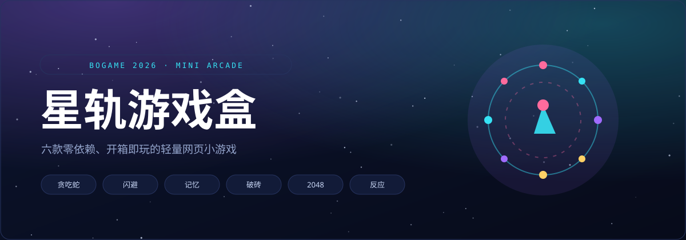

<br/><br/>

# BOGAME 2026 · 星轨游戏盒

**六款零依赖、开箱即玩的轻量网页小游戏**


> 不用安装、不用构建、不用联网 —— 双击 `index.html` 就能玩。

[🌐 在线试玩](https://1287361055-max.github.io/bogame2026/) &nbsp;·&nbsp;
[🎮 进入游戏大厅](index.html) &nbsp;·&nbsp;
[🖼️ 浏览展示图集](#-展示图集) &nbsp;·&nbsp;
[🚀 快速开始](#-快速开始)

</div>

---

## ✨ 项目简介

**BOGAME 2026 · 星轨游戏盒** 是一个用原生 HTML / CSS / JavaScript 写成的轻量网页小游戏合集。
六款小游戏共用一个大厅、一套视觉语言、一份本地高分存档，打开浏览器即可开玩。

整个项目没有框架、没有打包器、没有任何第三方运行时依赖：所有界面、动画、音效与游戏逻辑都在仓库里，
可以离线运行，也可以直接丢到任意静态托管服务上。

| 特性 | 说明 |
| :--- | :--- |
| 🎮 **六款游戏** | 街机、敏捷、记忆、经典、益智、反应，一盒打尽 |
| ⚡ **零依赖** | 不需要 `npm install`，不需要联网加载任何资源 |
| 🔊 **内置音效** | 用 Web Audio 实时合成，一键静音，无需音频文件 |
| 🏆 **本地高分** | 每款游戏独立记录最高分，写入浏览器 `localStorage` |
| 📱 **全端适配** | 键盘 / 鼠标 / 触摸 / 滑动 / 触屏方向键全部支持 |
| 🌙 **统一视觉** | 深空霓虹主题，响应式布局，窄屏自动切单列 |

---

## 🎮 项目列表

大厅首页支持按名称或类型实时搜索，点击卡片即可进入游戏。

| 展示图 | 游戏 | 类型 | 玩法简介 | 试玩 |
| :--- | :--- | :--- | :--- | :--- |
| 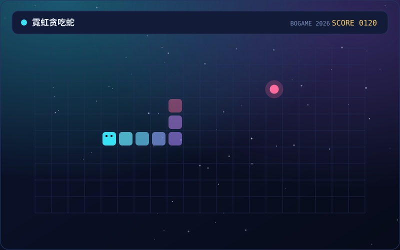 | **01 · 霓虹贪吃蛇** | 街机 / 敏捷 | 在 24×24 网格里收集光点，越吃越长；撞墙或撞到自己就结束，得分越高速度越快。 | [开始游玩 →](games/neon-snake.html) |
| 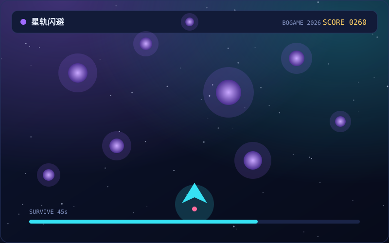 | **02 · 星轨闪避** | 动作 / 躲避 | 驾驶飞船穿过越来越密的陨石雨，每躲过一块 +10 分，坚持 45 秒通关。 | [开始游玩 →](games/star-dodge.html) |
| 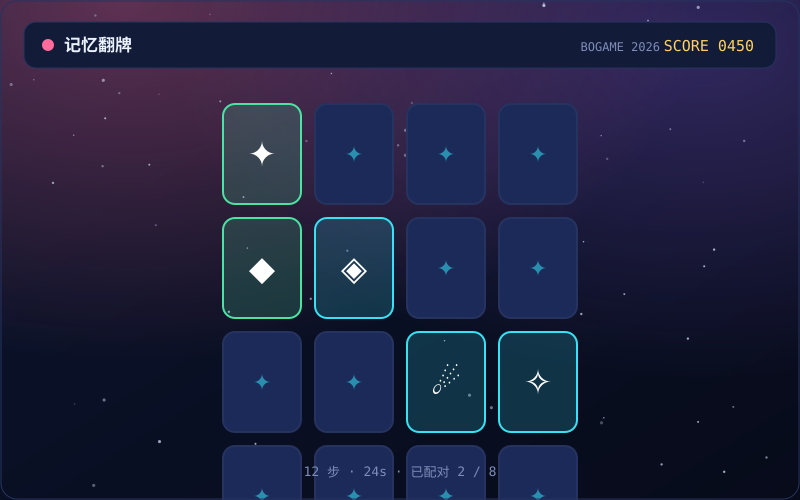 | **03 · 记忆翻牌** | 记忆 / 益智 | 16 张卡组成 8 对星图符号，用更少步数与更短时间清空牌桌，得分更高。 | [开始游玩 →](games/card-match.html) |
| 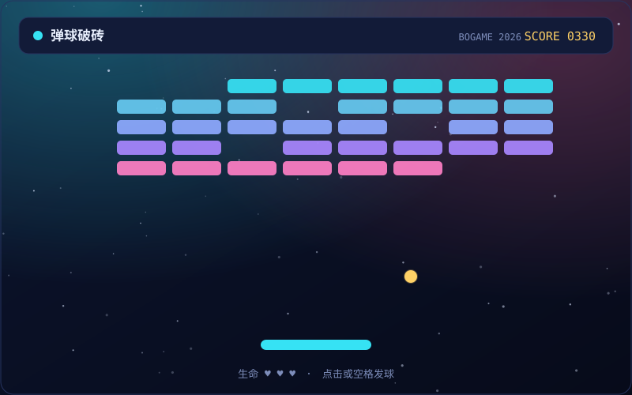 | **04 · 弹球破砖** | 经典 / 街机 | 移动能量挡板反弹光球，击碎整片砖阵，共 3 条命，挡板边缘可打出斜角。 | [开始游玩 →](games/brick-breaker.html) |
| 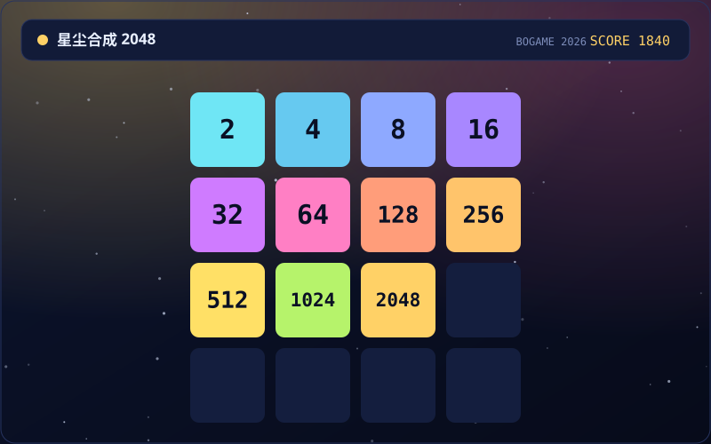 | **05 · 星尘合成 2048** | 益智 / 数字 | 四向滑动合并同数值星尘，一路合成 2048 星核；支持撤销上一步。 | [开始游玩 →](games/stardust-2048.html) |
| 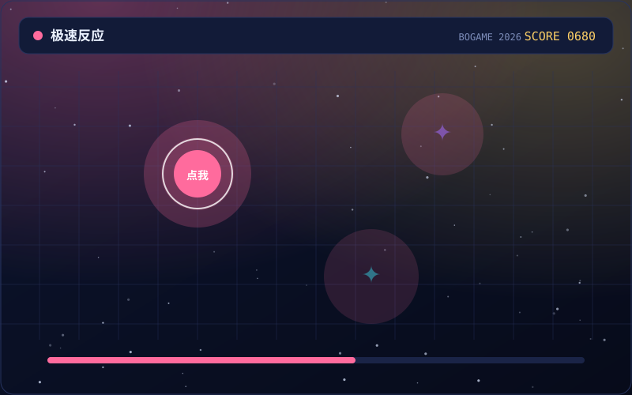 | **06 · 极速反应** | 反应 / 手速 | 30 秒内点亮随机出现的光点，连击越高加成越猛，点空或超时中断连击。 | [开始游玩 →](games/reflex-rush.html) |

---

## 🖼️ 展示图集

### 游戏大厅

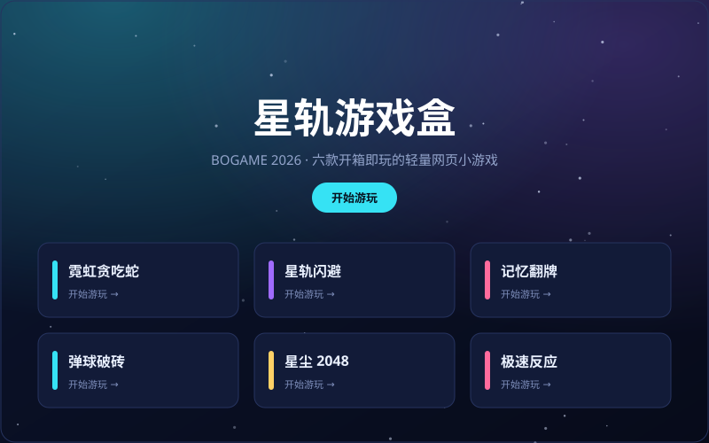

<sub>大厅首页：六款游戏卡片、实时搜索、统一顶栏与状态栏</sub>

### 六款游戏界面

<table>
  <tr>
    <td align="center" width="33%"><br/><sub>霓虹贪吃蛇</sub></td>
    <td align="center" width="33%"><br/><sub>星轨闪避</sub></td>
    <td align="center" width="33%"><br/><sub>记忆翻牌</sub></td>
  </tr>
  <tr>
    <td align="center"><br/><sub>弹球破砖</sub></td>
    <td align="center"><br/><sub>星尘合成 2048</sub></td>
    <td align="center"><br/><sub>极速反应</sub></td>
  </tr>
</table>

### 功能细节

<table>
  <tr>
    <td align="center" width="33%">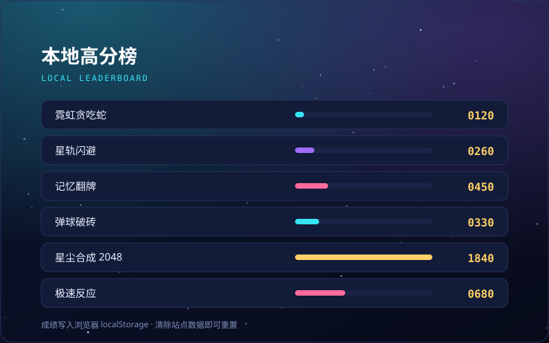<br/><sub>本地高分存档</sub></td>
    <td align="center" width="33%">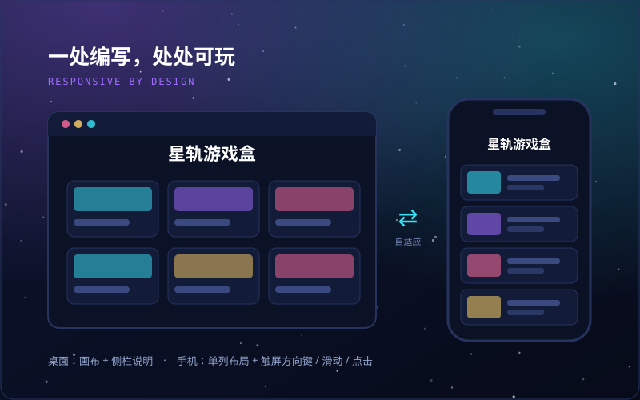<br/><sub>桌面 / 移动端自适应</sub></td>
    <td align="center" width="33%">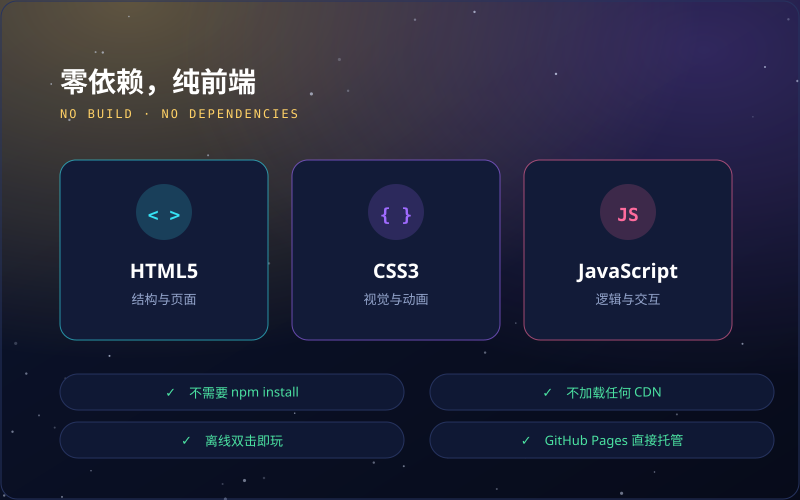<br/><sub>零依赖纯前端</sub></td>
  </tr>
</table>

<sub>全部展示图均为仓库内自带的手写矢量 SVG，位于 <code>assets/showcase/</code>，任意缩放清晰、无需联网。</sub>

---

## 🚀 快速开始

### 方式一：直接打开（推荐）

双击根目录的 [`index.html`](index.html)，浏览器里就能玩，无需任何环境。

### 方式二：本地静态服务

```bash
cd bogame2026
python -m http.server 8000
```

然后打开 <http://127.0.0.1:8000/>。

### 方式三：在线访问

启用 GitHub Pages 后访问：<https://1287361055-max.github.io/bogame2026/>

> 也可以把整个目录拖到任意静态托管（Netlify / Vercel / Cloudflare Pages / Nginx），无需配置构建命令。

---

## 🛠️ 技术栈与结构

- **HTML5**：大厅与 6 个游戏页面，`<canvas>` 用于实时绘制，DOM 网格用于卡牌与数字游戏
- **CSS3**：CSS 变量、渐变、3D 翻转、Grid / Flex 响应式布局，深空霓虹主题
- **JavaScript (ES6+)**：原生模块化的全局 `Arcade` 运行时 + 每款游戏独立逻辑
- **Web Audio API**：实时合成点击、得分、命中、胜利、失败音效
- **localStorage**：每款游戏独立的最高分与静音偏好

```
bogame2026/
├── index.html                  # 游戏大厅（项目列表 + 搜索 + 展示图集）
├── README.md                   # 项目说明
├── LICENSE                     # MIT 许可证
├── assets/
│   ├── css/arcade.css          # 全局主题与所有游戏组件样式
│   ├── js/arcade.js            # 公共运行时：存档 / 音效 / 画布 / 覆盖层 / 输入
│   └── showcase/               # 12 张矢量展示图（横幅、大厅、6 款游戏、3 张特性图）
├── games/
│   ├── neon-snake.html         # 6 个游戏页面（统一外壳）
│   ├── star-dodge.html
│   ├── card-match.html
│   ├── brick-breaker.html
│   ├── stardust-2048.html
│   ├── reflex-rush.html
│   └── js/                     # 6 份独立的游戏逻辑
└── scripts/
    ├── build_pages.py          # 一键重建 6 个游戏页面外壳
    └── gen_showcase.py         # 一键重建全部展示图
```

改完外壳或需要换展示图时，重新运行 `scripts/` 下对应脚本即可，生成结果可重复。

---

## 🏆 计分与存档

| 游戏 | 计分规则 |
| :--- | :--- |
| 霓虹贪吃蛇 | 每吃一个光点 +10，随分数提升速度 |
| 星轨闪避 | 每躲过一块陨石 +10，坚持满 45 秒通关 |
| 记忆翻牌 | 每配对 +100、每步 −5，通关再按用时加成 |
| 弹球破砖 | 每击碎一块砖 +10，3 条命 |
| 星尘合成 2048 | 合并时累加合并后的数值 |
| 极速反应 | 命中 +10 并叠加连击加成 |

所有最高分保存在浏览器 `localStorage`，键名统一以 `bogame2026:` 开头；清除站点数据即可重置。

---

## 🤝 参与贡献

欢迎补充新游戏、优化手感或改进视觉。建议流程：

1. Fork 本仓库并新建分支；
2. 在 `games/` 下添加页面与 `games/js/` 下的逻辑，复用 `Arcade` 运行时；
3. 更新 `index.html` 的项目列表卡片与 `README.md` 的项目列表；
4. 运行 `python scripts/build_pages.py` 与 `python scripts/gen_showcase.py` 保持生成文件同步；
5. 提交 Pull Request，并说明改动的游戏与验证方式。

---

## 📄 许可证

本项目采用 [MIT License](LICENSE)。可以自由使用、修改与分发，保留版权声明即可。

---

<div align="center">

**BOGAME 2026 · 星轨游戏盒** &nbsp;|&nbsp; 打开就能玩的小游戏合集 🎮

</div>
